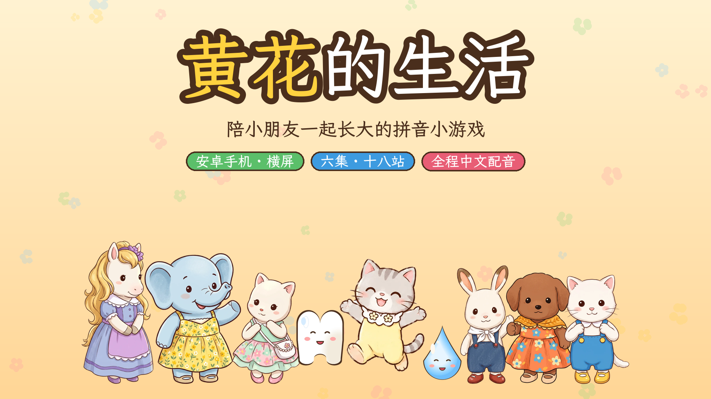

# 黄花的生活

陪小朋友一起长大的拼音小游戏（安卓手机，横屏）。主角是小猫黄花，和小马老师、毛毛、灰灰、草莓、贝壳、阿兰一起过日子：
跟着故事点一点，遇到拼音卡片听一听、选一选；学会一个好习惯，成长小黄花就开一片花瓣。

*A landscape pinyin adventure for young children (Android, WebView). Six story episodes, 18 stations; all voices are built in, no network needed.*

| 集 | 故事 | 站 |
|---|---|---|
| 第一集 | 捞月亮 | 教室 · 操场 · 中餐馆（洗手、不浪费） |
| 第二集 | 小水滴的旅行 | 图书馆 · 卫生间 · 小花园（安静、节约用水用纸） |
| 第三集 | 牙齿保卫战 | 黄花的家 · 超市 · 牙医诊所（早睡早起、刷牙、少吃糖） |
| 第四集 | 红绿灯小卫士 | 马路口 · 公交车 · 公园（过马路、让座、不跟陌生人走） |
| 第五集 | 过大年 | 年货集市 · 黄花家 · 年夜饭（贴春联、包饺子、存压岁钱） |
| 第六集 | 我会自己做 | 卧室 · 客厅 · 阳台（整理、家务、垃圾分类） |

现在的版本：v1.3（versionCode 4），包名 `com.hanzimaze.huanghua`。

## 在电脑上玩

游戏是一个网页（`huanghua.html` + `huanghua/`），用本地服务器打开：

    python -m http.server 8807
    # 浏览器打开 http://localhost:8807/huanghua.html （窗口横过来，像手机横屏那样）

网址后面可以加 `?play=s7a` 直接进某一关，`?auto&fast` 自动快速通关（测试用）。

## 打包安卓 APK

要装：Android SDK（build-tools 和 `platforms/android-34`，默认在 `%LOCALAPPDATA%\Android\Sdk`，或者设 `ANDROID_HOME`），
JDK 17（默认用 Android Studio 自带的 `jbr`，或者设 `JAVA_HOME`）。不用 Gradle。

    powershell -ExecutionPolicy Bypass -File build.ps1      # → release\HuanghuaLife.apk

- 手机上已经装了旧版本：先把 `android\AndroidManifest.xml` 里的 `versionCode` 加 1。
- 签名：`android\signing.local.ps1` 里写 `$KeyStore` 和 `$StorePass`（这个文件和钥匙都不进 git）。
  第一次打包时没有这个文件，脚本会在 `android\` 里新建一把本地钥匙。同一个包名的更新必须用同一把钥匙签名，
  换了钥匙就要先在手机上卸载旧版本。
- `android\src\` 是几个游戏共用的 WebView 外壳：全屏显示页面，配音缺了用系统 TTS 兜底，出错时显示崩溃报告
  （里面还有这个游戏没用到的相机、传感器功能）。横屏和震动权限写在 `android\AndroidManifest.xml`。
  打包时页面和 `huanghua/` 装进 APK 的 assets，游戏不用联网。

## 文件夹

| 位置 | 内容 |
|---|---|
| `huanghua.html`、`huanghua/` | 游戏本身：脚本、样式、图片、音乐、配音（`voice.js`）、字体子集 |
| `dev/` | 工具：台词和拼音（`content.py`）、配音、抠图、代码画的角色和物品、测试、介绍视频的录制和剪辑；说明在 `dev/README.md` |
| `art/` | 原图：角色、背景，以及 Gemini 画的图（`art/gemini2/` 是第三~六集） |
| `android/` | `AndroidManifest.xml`、图标、WebView 外壳源码 |
| `build.ps1` | 打包 APK |
| `release/`、`演示视频/` | 打包出来的 APK、介绍视频（都不进 git） |

改台词、加关卡、重新生成配音和图片：见 [`dev/README.md`](dev/README.md)。工具要的 Python 包在 `requirements.txt`。

`dev/font/` 里要放霞鹜文楷完整字体 `LXGWWenKai-Medium.ttf`（25 MB，不进 git，从 <https://github.com/lxgw/LxgwWenKai> 下载），
只有重新生成字体子集（`python dev/make_audio.py font`）和剪介绍视频时才要用；游戏用的是已经生成好的 `huanghua/font.woff2`。

## 素材和授权

- 角色原图（黄花和六位小伙伴）由家长提供；第二集背景用 Stable Diffusion XL 在本机生成；第三~六集的角色、物品、背景用 Google Gemini 生成；
  牙牙、滴滴、春联、汽车、红绿灯、烟花等用代码画。
- 配音：微软 Edge 神经网络声音（edge-tts）合成，生成的配音在 `huanghua/voice.js` 和 `dev/clips/`。
- 背景音乐：Kevin MacLeod（[incompetech.com](https://incompetech.com)）《Carefree》《Wallpaper》《Sneaky Snitch》《Monkeys Spinning Monkeys》
  《Fluffing a Duck》《Easy Lemon》《Merry Go》《Pixel Peeker Polka》，Licensed under Creative Commons: By Attribution 4.0
  （<http://creativecommons.org/licenses/by/4.0/>）。
- 字体：霞鹜文楷 LXGW WenKai，SIL Open Font License 1.1。
